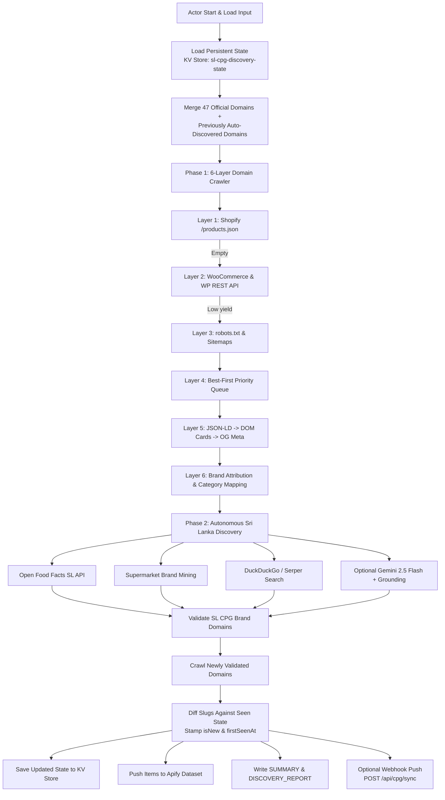

# Sri Lanka Official CPG Brand Scraper (Apify Actor)

An autonomous Apify Actor that crawls **official Sri Lankan CPG/FMCG brand websites and online supermarkets**, **automatically discovers missing Sri Lankan brands and new products on the internet**, tracks newly launched SKUs across runs (`isNew`, `firstSeenAt`), and exposes a clean **Product + Image Database API** via Apify's REST API and optional webhook push.

---

## Key Capabilities

- **Curated Sri Lanka CPG Registry**: Covers **66 official brand rows across 47 deduplicated Sri Lankan brand & supermarket domains** (Unilever `ustore.lk`, Darley Butler, CBL/Munchee, Hemas, Elephant House, Maliban, Cargills, Fonterra, Ambewela, Prima, Dilmah, Basilur, Wijaya, McCurrie, Nestlé, Link Natural, Swadeshi, Keells Super, Cargills Online, Glomark, and more).
- **6-Layer Intelligent Crawling Engine**: Automatically adapts to Shopify, WooCommerce, WordPress REST APIs, XML sitemaps, JSON-LD, DOM product cards, and OpenGraph pages without brittle per-site selectors.
- **Hybrid Autonomous Discovery (Sri Lanka)**:
  - **Zero-API-key by default**: Discovers new Sri Lankan products and missing brands via the **Open Food Facts Sri Lanka API**, **supermarket brand mining**, and **DuckDuckGo web search**.
  - **Optional AI & Search Upgrades**: Plug in a `serperApiKey` (Google Search `gl=lk`) and/or `geminiApiKey` (Gemini 2.5 Flash with Google Search grounding) for deeper discovery.
  - **Automatic Domain Validation**: Verifies every candidate brand domain is live, Sri Lanka-relevant, and exposes CPG/e-commerce signals before crawling and persisting it.
- **Cross-Run State & New-Product Diffing**:
  - Persists seen product slugs and validated brand domains in a named Apify Key-Value Store (`sl-cpg-discovery-state`).
  - Tags every scraped product with `isNew: boolean`, `firstSeenAt`, `isDiscoveredBrand`, and `discoveredVia`.
  - Automatically crawls newly discovered Sri Lankan brand domains on all future runs and prunes dead domains after 3 consecutive failures.

---

## Architecture Overview



---

## Input Configuration

All parameters are optional—running with `{}` crawls all 47 official domains plus previously discovered domains and runs zero-API-key autonomous Sri Lanka discovery.

| Field | Type | Default | Description |
| :--- | :--- | :--- | :--- |
| `domains` | `string[]` | `[]` | Optional list of domains or target IDs to crawl (e.g. `["ustore.lk", "elephanthouse.lk"]`). Leave empty for a full crawl. |
| `includeSupermarkets` | `boolean` | `true` | Include Sri Lankan online supermarkets (`keellssuper.com`, `cargillsonline.com`, `glomark.lk`). |
| `maxPagesPerDomain` | `integer` | `18` | Maximum pages to traverse per domain (`1`–`100`). |
| `maxProductsPerDomain` | `integer` | `60` | Maximum products to extract per domain (`1`–`500`). |
| `enableAutonomousDiscovery` | `boolean` | `true` *(when `domains` is empty)* | Enable autonomous Sri Lanka brand & product discovery. If `domains` is set and this is omitted, discovery is skipped unless explicitly set to `true`. |
| `enableOpenFoodFacts` | `boolean` | `true` | Query the free Open Food Facts Sri Lanka API (`countries=sri-lanka`, sorted by most recently modified). |
| `maxOpenFoodFactsPages` | `integer` | `3` | Number of 100-item pages to fetch from Open Food Facts (`1`–`10`). |
| `maxNewBrandsPerRun` | `integer` | `10` | Maximum newly discovered Sri Lankan CPG brand domains to validate and crawl per run (`0`–`50`). |
| `discoveryStateStoreName` | `string` | `"sl-cpg-discovery-state"` | Named Apify Key-Value Store for cross-run product slug and discovered-domain persistence. |
| `serperApiKey` | `string` *(secret)* | — | Optional [Serper.dev](https://serper.dev) key for Sri Lanka Google Search (`gl=lk`). Falls back to DuckDuckGo if omitted. |
| `geminiApiKey` | `string` *(secret)* | — | Optional Google Gemini API key (`gemini-2.5-flash` with Google Search grounding) for AI-assisted missing brand discovery. |
| `webhookSyncUrl` | `string` | — | Optional HTTP POST webhook URL (e.g. `https://your-api.example.com/api/cpg/sync`) to push scraped products in chunks of 50. |
| `webhookSyncSecret` | `string` *(secret)* | — | Sent as `x-cpg-sync-secret` header when calling `webhookSyncUrl`. |

### Example Inputs

**1. Daily Scheduled Production Run (Zero-API-Key)**
```json
{
  "includeSupermarkets": true,
  "maxPagesPerDomain": 18,
  "maxProductsPerDomain": 60,
  "enableAutonomousDiscovery": true,
  "enableOpenFoodFacts": true,
  "maxNewBrandsPerRun": 10,
  "webhookSyncUrl": "https://your-api.example.com/api/cpg/sync",
  "webhookSyncSecret": "your-secret"
}
```

**2. Enhanced Hybrid AI + Google Search Discovery Run**
```json
{
  "enableAutonomousDiscovery": true,
  "maxNewBrandsPerRun": 15,
  "serperApiKey": "your-serper-key",
  "geminiApiKey": "your-gemini-key"
}
```

**3. Fast Local Smoke Test**
```json
{
  "domains": ["ustore.lk", "elephanthouse.lk"],
  "maxPagesPerDomain": 3,
  "maxProductsPerDomain": 5,
  "enableAutonomousDiscovery": true,
  "maxOpenFoodFactsPages": 1,
  "maxNewBrandsPerRun": 2
}
```

---

## Output Data

### 1. Dataset Items (`ScrapedOfficialProduct`)
Each item pushed to the Apify Dataset follows this schema:

```json
{
  "slug": "sunlight-care-laundry-bar-120g",
  "name": "Sunlight Care Laundry Bar 120g",
  "brand": "Sunlight",
  "brandGroup": "Unilever Sri Lanka",
  "category": "Household",
  "description": "Official Sunlight product (120g) from Unilever Sri Lanka.",
  "unit": "120g",
  "suggestedPriceLkr": 145,
  "imageEmoji": "🧴",
  "imageUrl": "https://cdn.shopify.com/...",
  "source": "apify",
  "sourceType": "official",
  "sourceUrl": "https://ustore.lk/products/sunlight-care-laundry-bar-120g",
  "officialBrandUrl": "https://ustore.lk",
  "keywords": "sunlight care laundry bar 120g unilever sri lanka household",
  "extractionMethod": "shopify-json",
  "isNew": true,
  "firstSeenAt": "2026-11-23T16:55:40.000Z",
  "isDiscoveredBrand": false,
  "discoveredVia": null,
  "scrapedAt": "2026-11-23T16:55:40.000Z"
}
```

| Field | Values / Notes |
| :--- | :--- |
| `category` | One of `Dairy & Eggs`, `Bakery & Tea`, `Rice & Grains`, `Spices`, `Coconut & Oils`, `Household`, `Dry Rations`, `Pantry` |
| `extractionMethod` | `shopify-json`, `woo-store-api`, `wp-rest-api`, `json-ld`, `dom-card`, `og-meta`, `dom-detail`, `open-food-facts` |
| `sourceType` | `official`, `supermarket`, `discovered-brand`, `open-food-facts` |
| `isNew` | `true` on the first run a product `slug` is ever seen; `false` on subsequent runs |
| `firstSeenAt` | ISO-8601 timestamp of when the product `slug` was first discovered |
| `isDiscoveredBrand` | `true` if the product came from an autonomously discovered Sri Lankan brand |
| `discoveredVia` | `open-food-facts`, `supermarket-mining`, `web-search`, `serper`, or `gemini` |

### 2. Key-Value Store Outputs
- **`SUMMARY`** *(run KV store)*: Aggregate counts (`domainsTotal`, `domainsOk`, `domainsBlocked`, `totalProducts`, `newProductsCount`, `totalKnownProductsInState`, `totalDiscoveredDomainsInState`) plus per-domain `domainReports`.
- **`DISCOVERY_REPORT`** *(run KV store)*: Lists `sourcesUsed`, `openFoodFactsProductsAdded`, `missingBrandNamesFound`, `newlyDiscoveredDomains`, and up to 100 newly discovered products (`newProductsSample`).
- **`DISCOVERY_STATE`** *(named KV store `sl-cpg-discovery-state`)*: Persistent cross-run state storing `seenProducts`, `discoveredDomains`, and `knownMissingBrandNames`.

---

## Consuming the API

### Option A: Pull from Apify REST API
Fetch the latest successful run's products:
```bash
curl "https://api.apify.com/v2/acts/<YOUR_USERNAME>~sri-lanka-official-cpg-brand-scraper/runs/last/dataset/items?token=<APIFY_TOKEN>&status=SUCCEEDED&clean=true"
```

Fetch the latest run's `DISCOVERY_REPORT`:
```bash
curl "https://api.apify.com/v2/acts/<YOUR_USERNAME>~sri-lanka-official-cpg-brand-scraper/runs/last/key-value-store/records/DISCOVERY_REPORT?token=<APIFY_TOKEN>&status=SUCCEEDED"
```

Trigger a run programmatically:
```bash
curl -X POST "https://api.apify.com/v2/acts/<YOUR_USERNAME>~sri-lanka-official-cpg-brand-scraper/runs?token=<APIFY_TOKEN>" \
  -H "Content-Type: application/json" \
  -d '{"enableAutonomousDiscovery": true, "maxNewBrandsPerRun": 10}'
```

### Option B: Push Directly to a Custom Webhook
Set `webhookSyncUrl` and `webhookSyncSecret` in the Actor input. The Actor sends batched `POST` requests (50 products per chunk):
```http
POST /api/cpg/sync HTTP/1.1
Content-Type: application/json
x-cpg-sync-secret: <webhookSyncSecret>

{
  "mode": "push",
  "platform": "apify",
  "products": [ ... ]
}
```

---

## Local Development & Deployment

### Prerequisites
- Node.js 20+
- Apify CLI (`npm install -g apify-cli`)

### Run Locally
```bash
npm install
npm run build
npm start          # dev mode via tsx
npm run start:prod # compiled dist/main.js
```

To customize local test input, edit `storage/key_value_stores/default/INPUT.json`.

### Deploy to Apify Cloud
```bash
apify login
apify push
```

### Schedule Daily Runs
In **Apify Console → Schedules**, create a daily schedule (e.g. `0 20 * * *` UTC = 1:30 AM SLST) pointing to this Actor. Because `discoveryStateStoreName` defaults to `"sl-cpg-discovery-state"`, every daily run automatically remembers previously seen products and crawls newly discovered Sri Lankan brands.

---

## Project Structure

```text
.
├── .actor/
│   ├── actor.json           # Apify Actor specification
│   ├── input_schema.json    # Apify Console input UI & validation schema
│   └── dataset_schema.json  # Apify Dataset overview table schema
├── src/
│   ├── main.ts              # Actor entrypoint, orchestrator, KV reports & webhook push
│   ├── brands.ts            # 66 curated SL CPG brand rows, 47 domains, category/brand inference
│   ├── crawler.ts           # 6-layer intelligent crawling & multi-format extraction engine
│   ├── discovery.ts         # Hybrid autonomous Sri Lanka brand & product discovery engine
│   ├── state.ts             # Persistent named KV store for seen slugs & discovered domains
│   └── utils.ts             # Title cleaning, pack unit extraction, and slugification
├── Dockerfile               # Multi-stage Node 20 Apify container build
├── package.json
└── tsconfig.json
```
